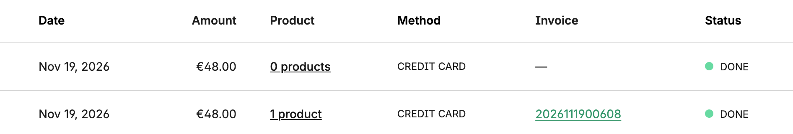

Risk-based AI coding: What works in financial regulations also works for AI-generated code.
To combat financial crime, regulators enforce a "risk-based approach" against illicit transactions.
What does that mean? Control-efforts must not be spread equally across all activity, but targeted according to a detailed risk analysis.

A similar approach works excellently for AI-generated code.
Integrating a new third-party dependency? Elevated risk of supply chain attacks: scrutinize it to reduce cybersecurity exposure.
Generating a slew of frontend-pages that replicate a pre-existing UI design? Sign off with light oversight, as long as agentic verification loops work as expected.
Spotted critical business logic? Double-check it and isolate it into separate files.
Spotted an "unfamiliar" pattern that does its job perfectly? Let it pass: an LLM knows thousands of patterns you are unfamiliar with, and future co-workers will use agents to explain them anyway.

Despite this, many teams still build a "piece of art", optimized for the limited human attention span.
But that is a losing battle: Restricting a codebase to the favorite patterns a single senior engineer can hold in their head is a lost cause.
It can be painful to let go of the "art craft" on which many engineers built their career identity for years.
Yet, "developers" are likely to become risk managers.
What risk-based regulations like DORA enforce at a macro-level may now become common at the micro-level.

The lesson is clear for me: Whoever sticks to old "minimal subset art coding" principles may soon get overrun by competitors that adopt a risk-based approach.
My article series on the Triple Loop Condition has a detailed risk breakdown across coding categories.

A final anecdote:
Just recently I ran into a sloppy financial coding error:
One of my credit cards was charged twice(!) for renewing the exact same domain.
Any decent fintech engineer should know how idempotency prevents errors like this.
(I won't share the names of the companies involved to avoid public blaming.)
But can we blame AI-generated code for it?
I do not think so; I rather believe the fault was a negligent risk analysis of the code that caused this error.

